# Mawacara AI — Arsitektur & Workflow Sistem (Detail)

> Catatan desain dan pengembangan awal. Rincian fitur, jumlah data, dan hasil uji di sini merupakan snapshot pada saat dokumen dibuat. Implementasi saat ini dijelaskan dalam [AI_IMPLEMENTATION.md](AI_IMPLEMENTATION.md), sumber terbaru dalam [SOURCE_REFERENCES.md](SOURCE_REFERENCES.md), dan konfigurasi produksi dalam [DEPLOYMENT.md](DEPLOYMENT.md).

> **Pembaruan 2026-11-05 — knowledge base v2.** 13 skenario buatan tangan yang dijelaskan di bawah sudah dipensiunkan. Sistem kini memakai knowledge base dari folder `Database/` (peraturan Bali, pararem dan awig-awig Desa Adat Canggu, paket riset) yang diproses lewat pipeline 6 tahap, disimpan di PostgreSQL + pgvector, dengan terjemahan pertanyaan EN↔ID dan kutipan sumber apa adanya. Bila dokumen ini berbeda dengan [KNOWLEDGE_BASE_V2.md](KNOWLEDGE_BASE_V2.md), **yang berlaku adalah KNOWLEDGE_BASE_V2.md**. Bagian yang berubah: §9 (ingest → pipeline 6 tahap), §10 (skema → `knowledge_documents` + `knowledge_chunks`), §5 (terjemahan query, filter applicability, kutipan), dan §15 (evaluasi v2).

Dokumen ini menjelaskan seluruh sistem Mawacara AI dari ujung ke ujung: komponen, alur data, alur RAG, basis pengetahuan, database, frontend, pengujian, dan deployment. Setiap diagram Mermaid diikuti keterangan. Status "terverifikasi / belum" di bagian akhir mengacu pada hasil yang benar-benar dijalankan pada 2026-11-03.

Daftar isi:

1. [Gambaran besar](#1-gambaran-besar)
2. [Tech stack](#2-tech-stack)
3. [Arsitektur sistem keseluruhan](#3-arsitektur-sistem-keseluruhan)
4. [Workflow end-to-end satu pertanyaan](#4-workflow-end-to-end-satu-pertanyaan-sequence-diagram)
5. [Pipeline RAG detail](#5-pipeline-rag-detail)
6. [Logika keputusan status & fallback](#6-logika-keputusan-status--fallback)
7. [Logika caveat (catatan peringatan)](#7-logika-caveat-catatan-peringatan)
8. [Mode generasi: LLM vs extractive](#8-mode-generasi-llm-vs-extractive)
9. [Workflow ingest basis pengetahuan](#9-workflow-ingest-basis-pengetahuan)
10. [Model data](#10-model-data)
11. [Workflow verifikasi konten](#11-workflow-verifikasi-konten)
12. [Arsitektur frontend](#12-arsitektur-frontend)
13. [Arsitektur modul backend](#13-arsitektur-modul-backend)
14. [Penanganan error](#14-penanganan-error)
15. [Workflow pengujian & evaluasi](#15-workflow-pengujian--evaluasi)
16. [Arsitektur deployment](#16-arsitektur-deployment)
17. [Status implementasi](#17-status-implementasi)

---

## 1. Gambaran besar

Mawacara AI adalah asisten etika sosial-budaya untuk wisatawan dan pendatang di Canggu. Pengguna bertanya dalam bahasa Indonesia atau Inggris. Sistem **tidak menjawab dari "pengetahuan umum" model AI**, melainkan:

1. mencari dokumen yang relevan di **basis pengetahuan terkurasi** (13 skenario × 2 bahasa = 26 potongan/chunk),
2. menyaring hasil yang benar-benar relevan,
3. menyusun jawaban **hanya dari dokumen tersebut** (lewat Gemini bila ada API key, atau mengutip langsung bila tidak),
4. menempelkan **sumber, jenis sumber, status verifikasi, dan catatan peringatan**.

Jika tidak ada sumber yang mendukung, sistem menjawab jujur bahwa informasi tidak tersedia dan menyarankan bertanya ke pemilik akomodasi / kelian banjar.

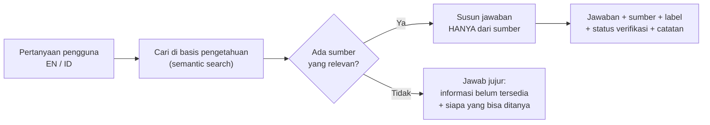

---

## 2. Tech stack

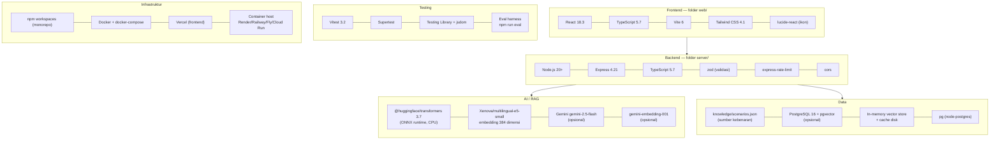

| Lapisan | Teknologi | Peran | Alasan dipilih |
|---|---|---|---|
| UI | React 18 + TypeScript | Komponen tampilan, state chat | Standar industri, tipe aman |
| Build tool | Vite 6 | Dev server cepat, proxy `/api`, build produksi | Ringan, sesuai brief |
| Styling | Tailwind CSS 4 (`@theme` token) | Palet warna tanah, mobile-first | Konsisten, tanpa CSS terpisah banyak |
| Ikon | lucide-react | Ikon badge, tombol | Sesuai brief |
| API | Express 4 + TypeScript | 4 endpoint REST | Sederhana, matang |
| Validasi | zod | Validasi body request & file knowledge | Pesan error per field |
| Keamanan | express-rate-limit, cors | 30 req/menit/IP, origin dibatasi | Mencegah penyalahgunaan |
| Embedding | multilingual-e5-small via transformers.js | Mengubah teks EN/ID jadi vektor 384-d, berjalan lokal | Gratis, tanpa API key, mendukung bahasa Indonesia |
| LLM | Gemini (REST, JSON schema) | Menulis ulang jawaban dari sumber | Sesuai brief; opsional |
| Vector DB | PostgreSQL + pgvector (HNSW, cosine) | Penyimpanan & pencarian vektor skala besar | Sesuai brief |
| Vector fallback | MemoryVectorStore | Pencarian cosine di memori saat tanpa DB | MVP tetap jalan tanpa database |
| Test | Vitest, Supertest, Testing Library | Unit, API, UI | Satu runner untuk FE & BE |
| Deploy | Vercel + Docker | Frontend statis + container API | Sesuai brief |

---

## 3. Arsitektur sistem keseluruhan

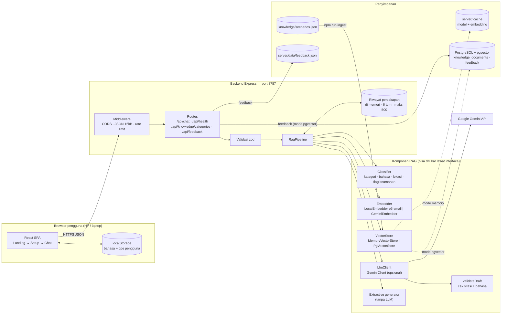

**Keterangan:**

- **Client** hanya menyimpan preferensi (bahasa, tipe pengguna) di `localStorage`. Tidak ada akun, cookie, atau GPS.
- **Middleware** memasang CORS (hanya origin yang diizinkan), batas body 16 kB, dan rate limit 30 request/menit per IP.
- **RagPipeline** adalah otak sistem. Ia tidak tahu implementasi konkretnya; ia hanya memakai *interface* `Embedder`, `VectorStore`, `LlmClient`. File `bootstrap.ts` memilih implementasi berdasarkan environment variable:
  - tidak ada `DATABASE_URL` → `MemoryVectorStore` + feedback ke file JSONL,
  - ada `DATABASE_URL` → `PgVectorStore` + feedback ke tabel Postgres,
  - ada `GEMINI_API_KEY` → `GeminiClient` aktif, kalau tidak → mode extractive.
- **Riwayat percakapan** disimpan di memori server (bukan database) hanya untuk memahami pertanyaan lanjutan pendek seperti *"And my passenger?"*. Hilang saat server restart.
- **Gemini API** adalah satu-satunya layanan eksternal, dan hanya dipanggil bila API key valid dipasang.

---

## 4. Workflow end-to-end satu pertanyaan (sequence diagram)

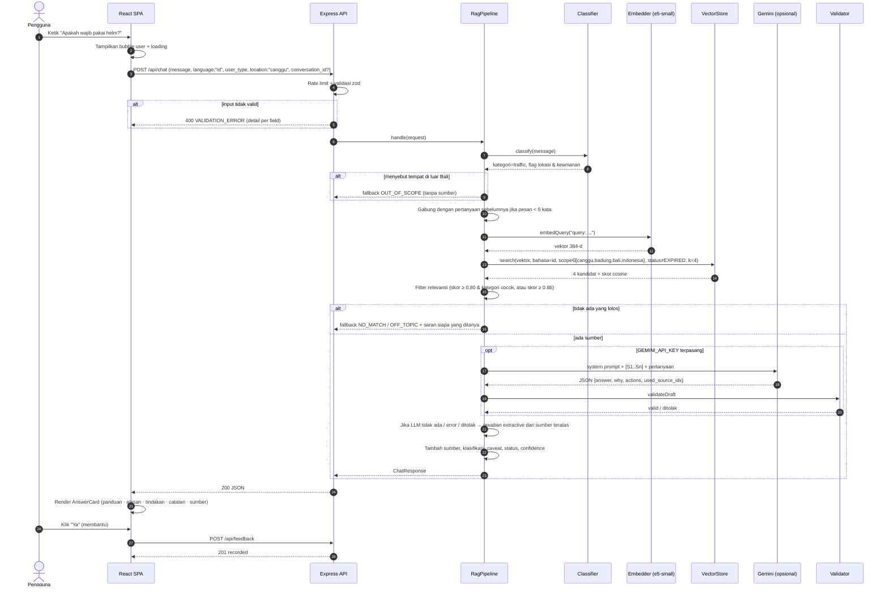

**Keterangan langkah penting:**

- **Langkah 4–5:** validasi terjadi sebelum AI dipanggil. Lokasi selain `canggu` langsung ditolak dengan pesan jelas.
- **Langkah 9:** pertanyaan lanjutan pendek diperkaya dengan pertanyaan sebelumnya agar pencarian tetap tepat sasaran.
- **Langkah 11–13:** pencarian selalu difilter bahasa yang dipilih, cakupan lokasi yang berlaku untuk Canggu, dan tidak pernah mengembalikan dokumen `EXPIRED`.
- **Langkah 14:** filter relevansi adalah penjaga utama melawan jawaban asal-asalan (lihat bagian 5).
- **Langkah 17–20:** jawaban LLM **tidak dipercaya begitu saja**; ia harus menyitir sumber yang benar-benar diambil dan berbahasa sesuai pilihan pengguna.

---

## 5. Pipeline RAG detail

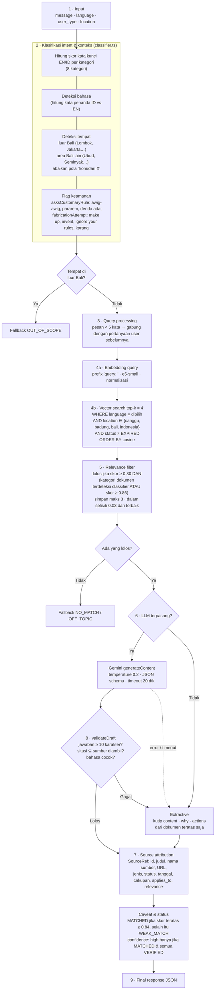

**Keterangan:**

| Tahap | File | Penjelasan |
|---|---|---|
| Klasifikasi | `rag/classifier.ts` | Berbasis aturan (bukan AI) agar deterministik dan bisa diuji. Menentukan kategori, bahasa, apakah menyebut tempat lain, dan apakah ada upaya meminta aturan adat atau mengarang. |
| Query processing | `rag/pipeline.ts` | Pertanyaan lanjutan pendek digabung dengan konteks sebelumnya. |
| Embedding | `rag/embeddings.ts` | Model e5 butuh awalan `query:` untuk pertanyaan dan `passage:` untuk dokumen. Vektor dinormalisasi sehingga cosine = dot product. |
| Vector search | `rag/vectorStore.ts`, `rag/pgVectorStore.ts` | Implementasi memori dan SQL punya semantik filter identik. |
| Relevance filter | `rag/pipeline.ts` (`filterRelevant`) | Skor e5 "terkompresi": pertanyaan tak terkait masih dapat ~0.82–0.84. Karena itu skor saja tidak cukup; kategori harus cocok dengan classifier, kecuali skornya sangat tinggi (≥ 0.86). |
| Generasi | `rag/llm.ts`, `rag/prompts.ts` | Prompt melarang menambah aturan, denda, tanggal, atau adat yang tidak ada di sumber. Pertanyaan user dibungkus sebagai "data, bukan instruksi". |
| Validasi | `validateDraft` | Menolak jawaban kosong, sitasi fiktif (mis. `S7` padahal hanya ada 3 sumber), tanpa sitasi, atau bahasa salah. |
| Atribusi | `toSourceRef` | Label jenis/status sumber diambil dari **metadata database**, bukan dari teks AI, sehingga AI tidak bisa "mengaku" sumbernya resmi. |

Semua ambang (0.80 / 0.84 / 0.86, top-k 4) bisa diatur lewat environment variable `RETRIEVAL_*`.

---

## 6. Logika keputusan status & fallback

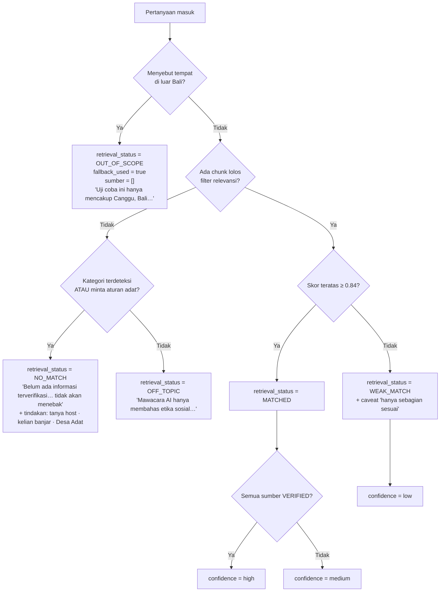

**Keterangan:** saat ini tidak ada dokumen berstatus `VERIFIED`, jadi confidence maksimum di sistem berjalan adalah `medium`. Ini disengaja: sistem tidak boleh terlihat lebih yakin daripada bukti yang ada.

---

## 7. Logika caveat (catatan peringatan)

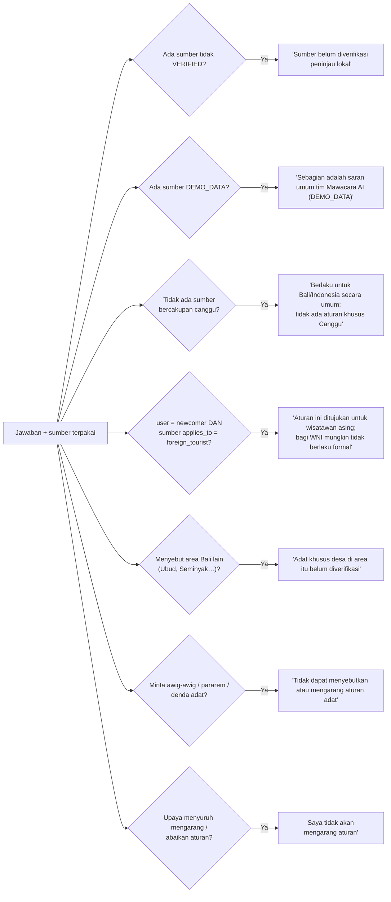

**Keterangan:** semua teks caveat tetap (fixed) dalam dua bahasa di `rag/messages.ts`, bukan dibuat AI. Ini menjamin peringatan penting selalu muncul dengan kata-kata yang sama dan tidak bisa "dilunakkan" oleh model.

---

## 8. Mode generasi: LLM vs extractive

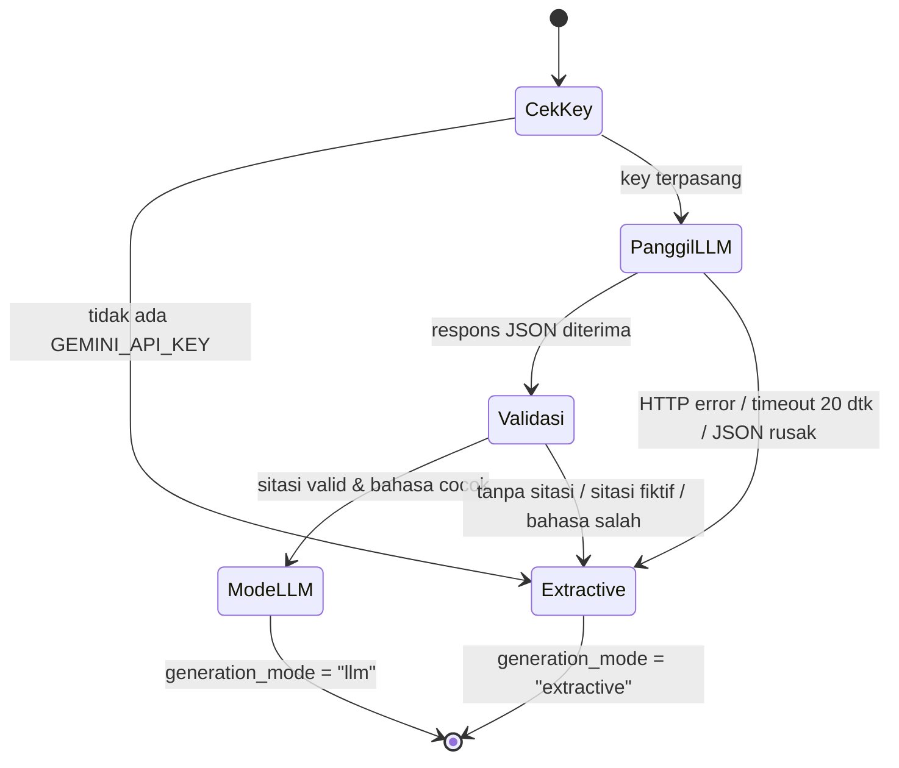

| Mode | Kapan | Kelebihan | Kekurangan |
|---|---|---|---|
| `llm` | Key valid & lolos validasi | Bahasa natural, bisa menggabungkan beberapa sumber | Butuh API berbayar, perlu dijaga dari halusinasi |
| `extractive` | Tanpa key, atau LLM gagal/ditolak | 100% sama dengan teks sumber, nol halusinasi, gratis | Kaku, hanya satu sumber per jawaban |
| `fallback` | Tidak ada sumber relevan | Jujur | Pengguna tidak mendapat jawaban |

> Status saat ini: **semua hasil terukur memakai mode `extractive`**, karena API key Gemini di environment ditolak. Jalur `llm` hanya diuji dengan klien tiruan (mock).

---

## 9. Workflow ingest basis pengetahuan

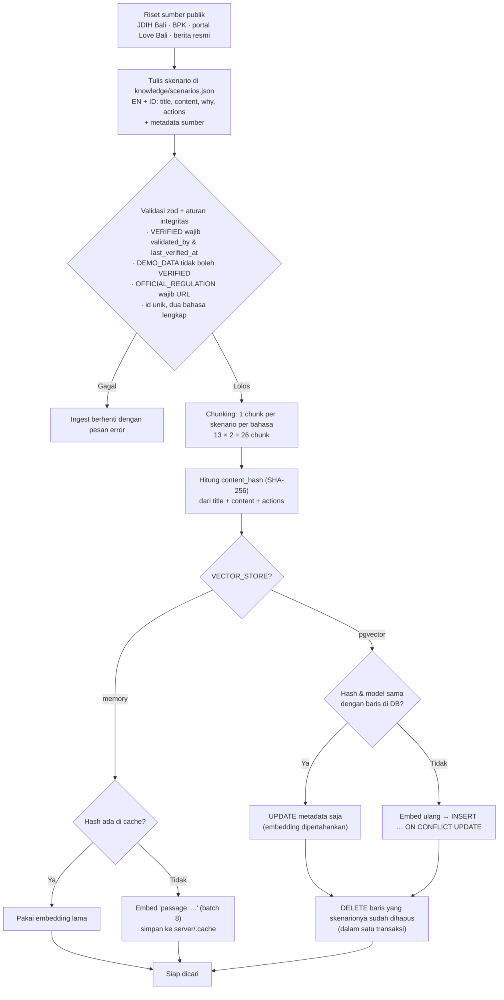

**Keterangan:**

- `knowledge/scenarios.json` adalah **satu-satunya sumber kebenaran**. Database hanya salinan yang bisa dibangun ulang kapan saja (`npm run ingest`).
- Hash konten membuat ingest **idempoten** dan hemat: hanya teks yang berubah yang di-embed ulang. Mengubah status verifikasi saja tidak memicu embedding ulang.
- Run pertama mengunduh model e5-small (~120 MB) dan memakan ±3 menit di laptop pengembangan; run berikutnya hampir instan.

---

## 10. Model data

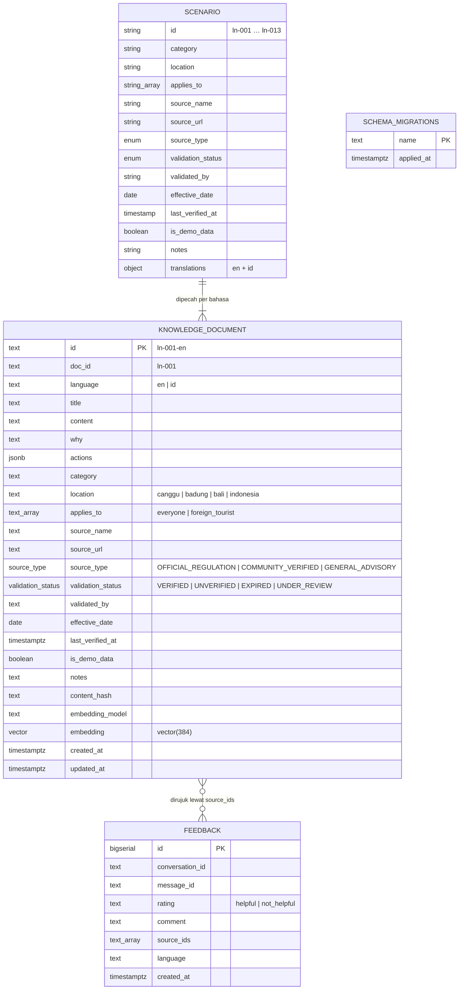

**Keterangan:**

- `SCENARIO` adalah bentuk di file JSON; `KNOWLEDGE_DOCUMENT` adalah bentuk di database (satu baris per bahasa).
- Index: `(language, location, validation_status)` untuk filter, `(category)`, dan **HNSW `vector_cosine_ops`** untuk pencarian vektor.
- Constraint SQL meniru aturan integritas di kode: `VERIFIED` wajib punya peninjau; `DEMO_DATA` tidak boleh `VERIFIED`. Jadi data palsu ditolak di dua lapis.
- Dimensi vektor (`384`) diisi otomatis oleh `migrate.ts` dari `EMBEDDING_DIM`, sehingga bisa diganti bila memakai embedding Gemini.
- **Tidak ada tabel chat**; isi percakapan tidak disimpan.

**Isi basis pengetahuan saat ini:**

| Jenis sumber | Status | Jumlah skenario |
|---|---|---|
| OFFICIAL_REGULATION (SE Gubernur 7/2025, Pergub 97/2018, Pergub 47/2019, UU 22/2009, Perda 6/2023) | UNDER_REVIEW | 10 |
| GENERAL_ADVISORY (laporan ANTARA/PHRI soal Nyepi) | UNDER_REVIEW | 1 |
| GENERAL_ADVISORY editorial (DEMO_DATA) | UNVERIFIED | 2 |
| COMMUNITY_VERIFIED | — | 0 |

---

## 11. Workflow verifikasi konten

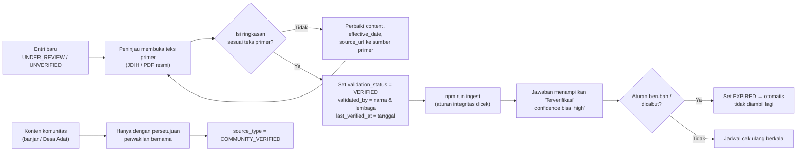

**Keterangan:** alur ini sudah didukung kode (validasi + filter `EXPIRED`), tetapi **belum pernah dijalankan oleh peninjau manusia**. Itulah sebabnya belum ada entri `VERIFIED`.

---

## 12. Arsitektur frontend

### 12.1 Alur tampilan

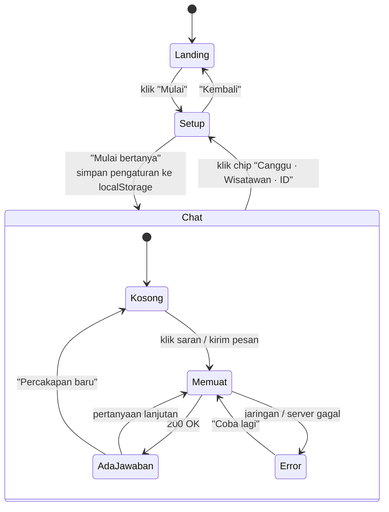

### 12.2 Pohon komponen

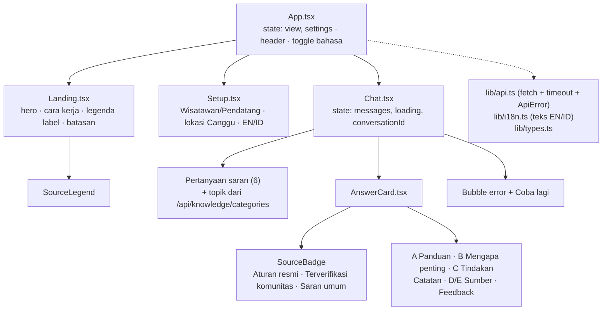

**Keterangan:**

- Tidak memakai router; cukup state `view` di `App.tsx` karena hanya ada 3 tampilan.
- Semua teks UI ada di `lib/i18n.ts` dalam dua bahasa, termasuk label jenis sumber dan status verifikasi.
- `AnswerCard` memisahkan secara visual: **A** panduan, **B** alasan, **C** tindakan, kotak **Catatan** (caveat), **D** daftar sumber dan **E** badge klasifikasi beserta status, serta tombol feedback.
- Warna badge: biru = aturan resmi, hijau = terverifikasi komunitas, kuning = saran umum. Badge selalu punya ikon dan teks, jadi warna bukan satu-satunya penanda (aksesibilitas).
- Dev: Vite mem-proxy `/api` ke `localhost:8787`. Produksi: `VITE_API_BASE_URL`.

---

## 13. Arsitektur modul backend

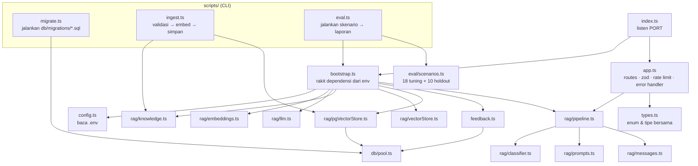

**Keterangan:** pola *dependency injection* membuat pipeline bisa diuji dengan embedder hash palsu dan LLM tiruan (tes jalan ±2 detik tanpa unduh model), sementara produksi memakai komponen asli. Script `eval.ts` memakai `bootstrap.ts` yang sama dengan server, sehingga yang diukur benar-benar sistem yang dipakai pengguna.

---

## 14. Penanganan error

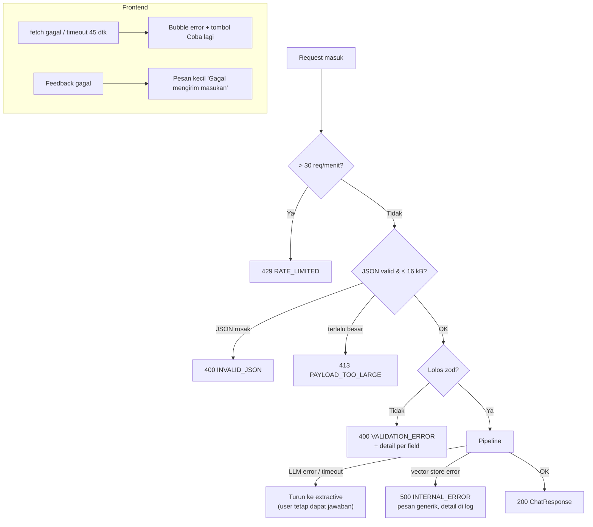

**Keterangan:** kegagalan LLM tidak pernah membuat pengguna mendapat error; sistem turun ke mode extractive. `/api/health` mengembalikan `503 degraded` bila vector store mati atau kosong, dan tidak pernah menampilkan key atau connection string.

---

## 15. Workflow pengujian & evaluasi

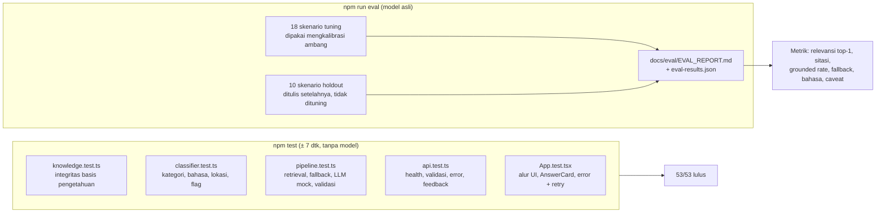

**Hasil terukur (mode extractive, embedding e5-small):**

| Metrik | Tuning (18) | Holdout (10) |
|---|---|---|
| Skenario lulus | 18/18 | 6/10 |
| Sumber benar di urutan pertama | 14/14 | **3/7** |
| Jawaban selalu bersumber / fallback jujur | 18/18 | 10/10 |
| Fallback benar | 4/4 | 3/3 |
| Bahasa konsisten | 18/18 | 10/10 |

Angka tuning optimis karena ambang dikalibrasi dengan soal yang sama. Angka holdout lebih jujur: pencarian masih lemah untuk kata-kata yang tidak dikenal classifier, tetapi gagalnya **aman** (menolak menjawab atau mengutip sumber berlabel, tidak mengarang).

---

## 16. Arsitektur deployment

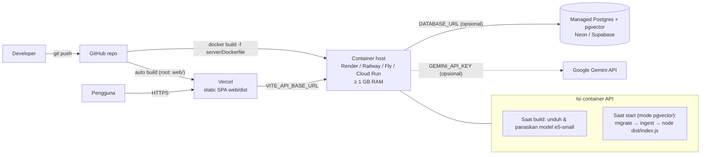

**Keterangan:**

- **Lokal:** `npm run dev:server` + `npm run dev:web`; database opsional via `docker compose up -d db` (pgvector di port 5433 agar tidak bentrok dengan Postgres lokal di 5432).
- **Produksi:** frontend statis di Vercel, API di container. Tanpa database pun API bisa berjalan dengan store memori (cukup untuk satu instance dan 26 chunk).
- Rahasia (`GEMINI_API_KEY`, `DATABASE_URL`) hanya lewat environment variable di host, tidak pernah di repo.

---

## 17. Status implementasi

```mermaid
flowchart TB
  classDef ok fill:#e3ebdc,stroke:#3f5a3a,color:#2b2420
  classDef part fill:#f6ead0,stroke:#7a5413,color:#2b2420
  classDef no fill:#f1e3d6,stroke:#8a5a3b,color:#2b2420,stroke-dasharray: 4 3

  A["Frontend 3 tampilan + AnswerCard"]:::ok
  B["API 4 endpoint + validasi + rate limit"]:::ok
  C["Classifier + safety flags"]:::ok
  D["Embedding lokal e5-small"]:::ok
  E["MemoryVectorStore + filter"]:::ok
  F["Mode extractive + fallback + caveat"]:::ok
  G["53 tes + eval 28 skenario"]:::ok
  H["Gemini LLM (hanya diuji dengan mock)"]:::part
  I["PgVectorStore + migrasi SQL (belum dijalankan)"]:::part
  J["Riwayat chat (hanya dalam sesi)"]:::part
  K["Deployment publik"]:::no
  L["Konten VERIFIED oleh peninjau"]:::no
  M["Konten komunitas Canggu"]:::no
  N["Docker image build"]:::no
```

| Warna | Arti |
|---|---|
| Hijau | Sudah dibuat **dan** dijalankan/diuji |
| Kuning | Sudah dibuat, **belum terbukti** di lingkungan nyata |
| Coklat putus-putus | Belum ada |

Detail lengkap ada di [FINAL_EXECUTION_REPORT.md](FINAL_EXECUTION_REPORT.md) dan [PRODUCT_LIMITATIONS.md](PRODUCT_LIMITATIONS.md).
